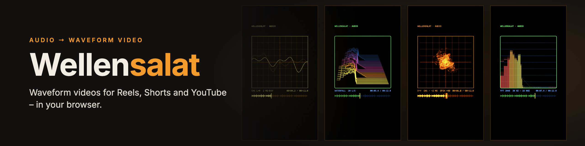
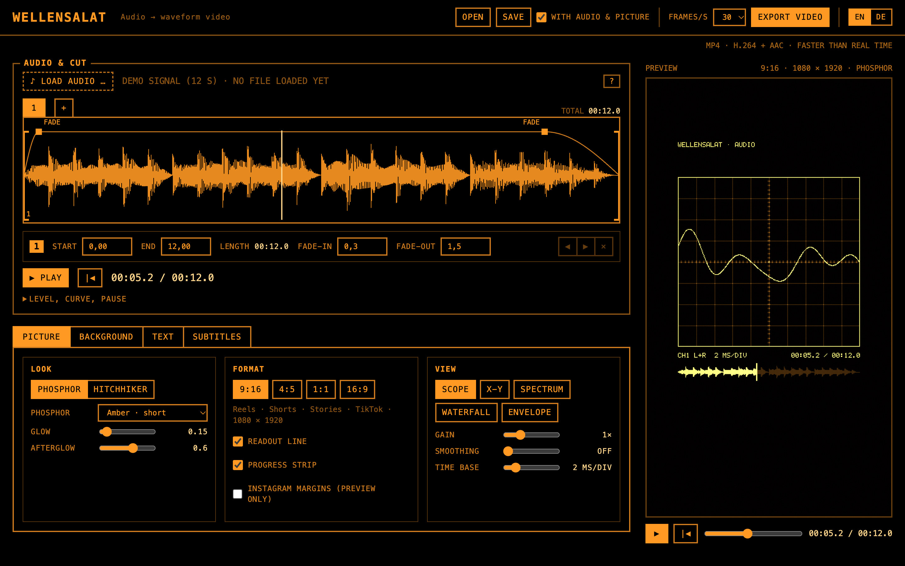

A browser tool that turns an audio file into an **animated waveform video** for Instagram Reels, YouTube Shorts, TikTok or YouTube. Cut and fade the audio, pick a view and a look, add a title, a background picture and subtitles, and export an MP4. Everything runs in your browser – no install, nothing is uploaded.

**Live:** https://sonarkon.github.io/Wellensalat/

[](https://ko-fi.com/S7Z228X1UL)



## Contents

- [Quick start](#quick-start)
- [Audio and cut](#audio-and-cut) – ranges · fades · pause
- [Picture](#picture) – views · looks · formats
- [Background](#background) · [Text](#text) · [Subtitles](#subtitles)
- [Export](#export) · [Project files](#project-files)
- [Language](#language) · [Privacy](#privacy)
- [Run locally](#run-locally) · [Version](#version) · [Credits](#credits) · [License](#license)

## Quick start

1. **Load audio** – the button, or drop a file anywhere on the page (WAV, MP3, M4A, OGG, FLAC). A demo signal plays until you do.
2. Drag across the waveform to choose the part you want, and set the **fades**.
3. Under **Picture**, choose a **view**, a **look** and a **format** (9:16 for Reels and Shorts).
4. Optionally add a **title**, a **background picture** and **subtitles**.
5. Press **Export video**. The MP4 has the size of the chosen format.

<kbd>Space</kbd> plays and stops, <kbd>I</kbd> / <kbd>O</kbd> set the start / end of the active range at the play position.

## Audio and cut

- **Ranges:** the tabs above the waveform. **+** adds another range (as long as the active one); the ranges are joined in the order of their tabs. ◀ ▶ reorder, ✕ removes.
- On the waveform: brackets **[ ]** = start / end · squares at the top = fades · click into a range = jump there, **drag it to move the whole range** · drag outside the ranges = choose the active range anew.
- **Zoom:** mouse wheel over the waveform (shift + wheel or a sideways swipe moves along), or − / + / ↔. While playing, the zoomed view follows the playhead.
- **Fades** per range, with a soft, linear or exponential curve. Where a fade-out meets the next fade-in, the two ranges **cross-fade** (overlap = the shorter fade).
- **Pause between ranges** puts silence between them instead; the fades then go out into the silence and come back from it.
- **Normalize** (−1 dBFS) and a **level** control. A note appears when the clip gets longer than 60 or 90 seconds.

## Picture

### Views

| View | What it shows |
|---|---|
| **Scope** | A triggered oscilloscope trace; *time base* sets the window. |
| **X-Y** | The signal against itself a few milliseconds later (loops), or stereo L/R. *Spin* turns the figure in space around a third axis, *tilt* tips it forward. |
| **Spectrum** | FFT columns on a log frequency axis (30 Hz – 16 kHz) with peak hold. |
| **Waterfall** | Spectra as ridge lines receding in depth. |
| **Envelope** | ±3 seconds around now: the past bright, the future dim. |

*Gain* scales the picture, *smoothing* calms it down (a low-pass on the signal views, an average over time on the spectral ones). A readout line (view, time base, timecode) and a strip with the whole clip can be switched on and off.

### Looks

- **Phosphor** – an 80s raster terminal: one coarse pixel grid, a 5×7 pixel font, amber phosphor with afterglow, glow and scanlines. Presets from short amber to *REM* (deep, long afterglow, strong glow).
- **Hitchhiker** – flat multicolour vector graphics on black: yellow line work, blue titles, green labels, graded colours.

*Glow* and *afterglow* can be set freely for each look.

### Formats

| Format | Size | For |
|---|---|---|
| 9:16 | 1080 × 1920 | Reels · Shorts · Stories · TikTok |
| 4:5 | 1080 × 1350 | Instagram feed |
| 1:1 | 1080 × 1080 | Square |
| 16:9 | 1920 × 1080 | YouTube · landscape |

In 9:16 everything stays inside Instagram's safe zone; *Instagram margins* shows the covered areas in the preview.

## Background

A picture always **fills the frame**: *size* (100–400 %) and *left/right*, *up/down* move it within its overhang – or drag it in the preview and use the mouse wheel. *Opacity* and *darken panel* keep the waveform readable. In the phosphor look the picture is rastered (4 grey levels, Bayer dither) and tinted like the rest.

## Text

- **Header** (small) and **title** (large) at the top. The title can be **typed in** like a terminal line. Anything too wide runs through as a **ticker**.
- A fixed **text** at the bottom, shown while no subtitle is running. Two lines at full size; a longer text gets smaller (up to four lines), anything longer still runs through as a ticker.

## Subtitles

- **Recognise:** speech recognition with **Whisper**, entirely in the browser (Tiny 40 MB · Base 80 MB · Small 250 MB, downloaded once and then cached). English, German or automatic.
- **Two voices:** each line has an **A/B** voice; A is set flush left, B flush right (**⇄** swaps the sides), and in the Hitchhiker look B gets its own colour. *Separate voices* assigns A/B automatically with a speaker-segmentation model (pyannote, ~6 MB) – check the result.
- Lines are typed in two at a time. In the list: ▶ jumps to a line, ↑ ↓ merge it with the line above / below, ✕ deletes.
- **SRT** in and out (times are times in the finished clip; the voice is kept as `[A]` / `[B]`).
- Subtitles stay anchored to the speech: if you re-cut, they move with it.

## Export

- **Chrome, Edge and newer Safari:** frame by frame with WebCodecs – **H.264 + AAC in an MP4**, faster than real time and exactly like the preview. 30 or 60 frames per second.
- **Other browsers:** a real-time recording of the preview (MP4 or WebM, depending on the browser); keep the tab in front while it records.

## Project files

**Save** writes everything except the video – ranges and fades, picture settings, texts, subtitles – as a `.wellensalat.json`. With *with audio & picture* the audio file and background picture are packed in, so the project opens anywhere; without, the file is small and asks for the audio again when you open it. **Open** (or drop the file on the page) restores it.

## Language

English by default; **EN / DE** at the top right switches to German. The labels drawn into the video follow the language too.

## Privacy

Your audio, pictures and projects never leave your computer. The page loads a few things from public CDNs on first use: the MP4 muxer ([mp4-muxer](https://github.com/Vanilagy/mp4-muxer)) when you export, and [transformers.js](https://github.com/huggingface/transformers.js) with the Whisper / pyannote models from Hugging Face when you use speech recognition.

## Run locally

The page uses JavaScript modules, so it needs a web server – double-clicking `index.html` does not work:

```sh
python3 -m http.server 8000
```

then open http://localhost:8000. Adding `#at=5.2` to the address opens the demo at 5.2 seconds.

## Version

The footer shows the version and a build id (the content hash of the files), e.g. *Wellensalat v1.0.0 · 583ff3f* – click it to get to this repository. Saved projects record the version they were made with.

## Credits

- The phosphor look comes from a stage FUI (an 80s "brain-wave" terminal) made for a theatre production of *The Lathe of Heaven*.
- The Hitchhiker look is inspired by the vector animations of the 1981 BBC *Hitchhiker's Guide to the Galaxy* TV series.
- Speech recognition: [Whisper](https://github.com/openai/whisper) via [transformers.js](https://github.com/huggingface/transformers.js); voices: [pyannote segmentation 3.0](https://huggingface.co/pyannote/segmentation-3.0); MP4: [mp4-muxer](https://github.com/Vanilagy/mp4-muxer).

## Support

If Wellensalat is useful to you, you can buy me a coffee:

[](https://ko-fi.com/S7Z228X1UL)

## License

MIT – see [LICENSE](LICENSE).
